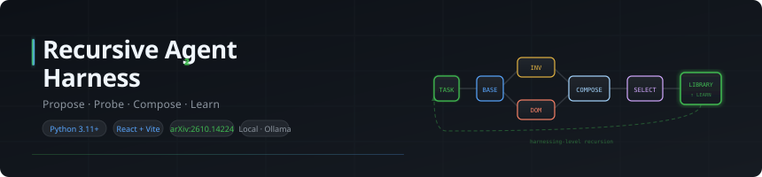

# Recursive Agent Harness

<p align="center">
  
</p>


A local Python + React implementation of the two-loop architecture from **[Harness²: Recursive Agent Harnessing for an Open World](https://arxiv.org/abs/2610.14224)** (Xu et al., 2026, arXiv:2610.14224).

## What it does

An LLM agent's performance depends not only on the underlying model but on its **harness** —
the system prompt, guardrails, memory, tool guidance, skills, scripts, subagents, and middleware
that surround it. This project lets you improve that harness automatically and accumulate the
lessons across tasks, without touching model weights and without needing ground-truth labels.

**Task-level recursion** refines the harness for the current task:

1. Execute the current harness as a baseline; record trajectory and deliverable.
2. An `InvariantEditor` proposes changes targeting task-agnostic weaknesses (planning, tool use,
   context management). A `DomainEditor` proposes domain-specific procedures.
3. Each candidate harness is probed on the same task under identical conditions.
4. A `Composer` reads all behavioral contrasts and merges, keeps, drops, or revises changes
   per component — every decision tied to a concrete observed fact, not a presumed score.
5. A `BlindSelector` picks the best output from anonymous deliverables (no harness identity exposed).
6. A `Reflector` attributes behavioral differences to specific components and extracts a reusable lesson.

**Harnessing-level recursion** improves future tasks:

7. If reflection produces a supported lesson and the harness changed, the adopted harness and
   `EXPERIENCE.md` are stored in the improvement library.
8. Future tasks always start from `harnesses/base`. The library is passed to editors as context so
   lessons inform new proposals without being blindly inherited.

---

## Harness components

Eight editable files matching the paper's C1–C8:

| # | Component | File | When active |
|---|---|---|---|
| C1 | System prompt | `systemprompt.md` | Every model call |
| C2 | Guardrails | `guardrails.md` | Every model call |
| C3 | Memory | `LongTermMEMORY.md` | Every model call |
| C4 | Tool guidance | `tool_guidance.md` | Every model call |
| C5 | Subagents | `sub_agents/*/AGENT.md` | Inert — dispatch not yet implemented |
| C6 | Skills | `skills/*/SKILL.md` | On keyword match at run start (on-demand `skill tool` not yet implemented) |
| C7 | Scripts | `scripts/*.py` | Inert — sandbox execution not yet implemented |
| C8 | Plugins / middleware | `plugins/*.py` | Inert — hook invocation not yet implemented |

---

## Requirements

- **Python 3.11+**
- A running [Ollama](https://ollama.com) instance **or** any OpenAI-compatible endpoint
- **Node 18+** for the web dashboard

```sh
python -m pip install -e ".[test,api]"
ollama pull qwen3.5:4b
ollama pull nomic-embed-text:latest
```

With Poetry:

```sh
poetry install -E api
```

---

## Quick start

### CLI

```sh
# Baseline run only (no improvement)
python -m app run-task --task examples/customer_issue.md

# One improvement round (parallel, k=1)
python -m app run-task --task examples/customer_issue.md --mode parallel --k 1

# Three parallel improvement branches
python -m app run-task --task examples/customer_issue.md --mode parallel --k 3

# Three sequential improvement steps
python -m app run-task --task examples/customer_issue_2.md --mode sequential --k 3
```

Attach source files explicitly or let them be discovered from an adjacent `<task>_sources/` folder:

```sh
python -m app run-task --task examples/customer_issue.md \
  --source examples/customer_issue_sources/order.md \
  --source examples/customer_issue_sources/account.md
```

Source paths must remain within the working directory. The agent can read sources and write
only into its run's `output/` directory.

### Library

```sh
python -m app library list
python -m app library inspect entry_001
```

### Compare two runs

```sh
python -m app compare-runs <execution_id_1> <execution_id_2>
```

---

## Web dashboard

```sh
# API server
poetry run uvicorn app.api.routes:create_app --factory --reload --port 8000

# Frontend (separate terminal)
cd frontend
npm install
npm run dev
```

Open `http://localhost:5173`. Vite proxies `/api` to the FastAPI backend.

| Page | What it shows |
|---|---|
| Overview | Task count, library entries, active runs |
| New task | Objective, domain, source uploads, improvement mode and k |
| Tasks | All tasks with search |
| Live run | Pipeline graph with SSE updates; Output / Trajectory / Tools / Harness / Metrics / Candidates / Contrasts / Composition / Events tabs |
| Harness diff | Monaco side-by-side diff of base vs. every candidate component |
| Harness explorer | Browse harness versions and their files |
| Improvement library | Browse and inspect saved experiences |
| Evaluation | Operational metrics — latency, token usage, tool calls |
| Settings | Provider, model, base URL, API key |

---

## Run records

Every task and execution is persisted under `runs/<task_id>/`:

```
runs/<task_id>/
  task.json                  task definition
  pipeline.json              full pipeline result (steps, metrics, library entry)
  jobs/<run_id>.json         SSE event log for this run
  <execution_id>/
    task.json                task snapshot
    harness/                 exact harness snapshot used for this execution
    workspace/               copied source files + agent output/
    execution.json           full ExecutionRecord
    trajectory.json          every model request/response and tool call
    tool_calls.json          tool calls only
    deliverable.md           final agent deliverable
    metadata.json            status, timing, token usage
```

The improvement library stores complete adopted harnesses:

```
improvement_library/<domain>/entry_###/
  EXPERIENCE.md              cue, lesson, evidence, attributions
  harness/                   full harness snapshot at adoption
```

---

## Tests

```sh
pytest
```

Tests cover:

- Full pipeline with a scripted provider (no live model needed)
- Parallel and sequential recursion width and depth
- Experience retrieval without replacing the base harness
- Executor harness snapshots and path-escape guards
- Basic API job-status responses

---

## Project structure

```
app/
  core/          Shared models, config, enums
  harness/       Harness loading, validation, diffing, cloning
  executor/      AgentExecutor — bounded execution with durable records
  improvement/   Editors, ProbeRunner, Composer, BlindSelector, Reflector
  orchestration/ Pipeline (task-level + harnessing-level recursion)
  library/       ImprovementLibrary — LanceDB index + filesystem store
  llm/           Provider abstraction (Ollama / OpenAI-compatible)
  api/           FastAPI routes and SSE streaming dashboard
frontend/        React + Vite SPA (React Flow pipeline graph, Monaco diff editor)
harnesses/base/  Default harness (C1–C8 component files)
prompts/         Stage prompts (reflector, selector, composer, editors)
examples/        Sample tasks and source files
tests/           pytest test suite
```

---

## Scope and correctness note

Behavioral contrasts identify observable differences in trajectory and deliverable. They do not
establish task correctness. A candidate that produces a longer or more structured output is not
automatically better — that is why the `BlindSelector` evaluates anonymous deliverables against
the task description, and why `Reflector` requires attributions to be grounded in quoted evidence.
Benchmark scores are reserved for external evaluation and are never exposed to the improvement loop.
