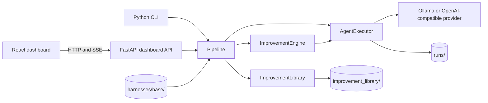

# Architecture

## System overview

Recursive Agent Harness is a local Python application with a React dashboard. It executes a task against a versioned filesystem harness, probes proposed harness changes, compares observed behavior, selects a deliverable, and can retain an evidence-backed lesson for later tasks. See `PRD.md` for user-facing behavior.

## Modules and responsibilities

| Path | Responsibility |
| --- | --- |
| `app/core/` | Pydantic task and experiment records, enums, environment configuration. |
| `app/harness/` | Load, validate, clone, version, and diff harness component files. The model owns `safe_path`; the loader re-exports it for existing callers. |
| `app/executor/` | Run bounded model/tool turns in a per-execution workspace and persist trajectories, tool calls, snapshots, and deliverables. |
| `app/improvement/` | Produce invariant and domain candidates, probe them, compare behavior, compose changes, select anonymous outputs, and reflect on evidence. |
| `app/orchestration/` | Coordinate baseline, parallel or sequential recursion, selection, reflection, and library updates. |
| `app/library/` | Store adopted harness snapshots and `EXPERIENCE.md`; index metadata with LanceDB vectors and rank retrieval by embedding similarity, with a keyword fallback. |
| `app/benchmark/` | External verifier interface, separate model judge, and result writer; private rubric and scores stay outside pipeline records. |
| `app/llm/` | Provider interface and HTTP adapters for Ollama and OpenAI-compatible chat endpoints. |
| `app/api/` | FastAPI task, run, harness, library, model, settings, and evaluation endpoints; live run events use SSE. |
| `frontend/` | React/TypeScript single-page dashboard; Vite proxies `/api` to the local backend. |
| `examples/` | Bundled task definitions and optional source notes; `GET /api/examples` serves three allowlisted examples for one-click runs. |

## Execution and data flow

1. CLI (`app/__main__.py`) or the dashboard creates a task with an objective, domain, and optional source files. For an example, the dashboard fetches its bundled definition from `GET /api/examples`. A quick run puts the notes in the objective and starts a base execution; a full improvement run uploads them as source files. `Pipeline` always loads `harnesses/base` at the start of a task.
2. `AgentExecutor` snapshots the harness into a run directory, copies allowed sources into an isolated workspace, and exchanges JSON actions with the model. Available actions are list, read, write under `output/`, `run_script` (executed in a restricted subprocess), `plugin_hook` (executed in a restricted subprocess), and final. Generated files are restricted to the execution workspace's `output/` directory.
3. In improvement mode, the engine probes baseline and edited harnesses, records behavioral contrasts, composes candidate changes, and probes successor harnesses. Parallel mode explores `k` branches; sequential mode chains `k` rounds (`1 <= k <= 5`).
4. `BlindSelector` sees anonymous deliverables. `Reflector` can produce an evidence-backed lesson. The library stores a selected changed harness as a **pending** entry (only when the required lesson and helped attribution are present) that the user must explicitly adopt; later tasks still start from the common base and retrieved lessons inform editors rather than replacing it.
5. Run records live under `runs/<task_id>/`; library entries live under `improvement_library/<domain>/`. Both directories are local runtime data and are ignored by Git.
6. An active run can be cancelled through `DELETE /api/runs/{run_id}`. The API cancels its asyncio task, persists a terminal job event, and closes the SSE stream; the executor records a cancelled execution when cancellation occurs during a model/tool turn. Job records include mode and `k` from launch so the dashboard can render the correct progress timeline before completion.

## Technology and boundaries

- Backend: Python 3.11+, Pydantic, HTTPX, PyPDF, LanceDB; optional FastAPI and Uvicorn for the API.
- Frontend: React 19, TypeScript, Vite, React Router, TanStack Query, React Flow, Monaco, Tailwind CSS, and Lucide icons.
- Settings come from environment variables or `.env`; process environment takes precedence. The default provider is local Ollama using `qwen3.5:4b`.
- Source paths must stay under the configured source root. The executor validates paths and size limits; generated files are restricted to the execution workspace's `output/` directory.
- Harness subagents, scripts, and plugins are handled as follows: subagents remain data-only (no dispatch yet); scripts and plugins are executed through restricted subprocess sandboxing via the `run_script` / `plugin_hook` tool actions; skills are selected by keyword at run start. Retrieval is hybrid (embedding similarity with keyword fallback).
